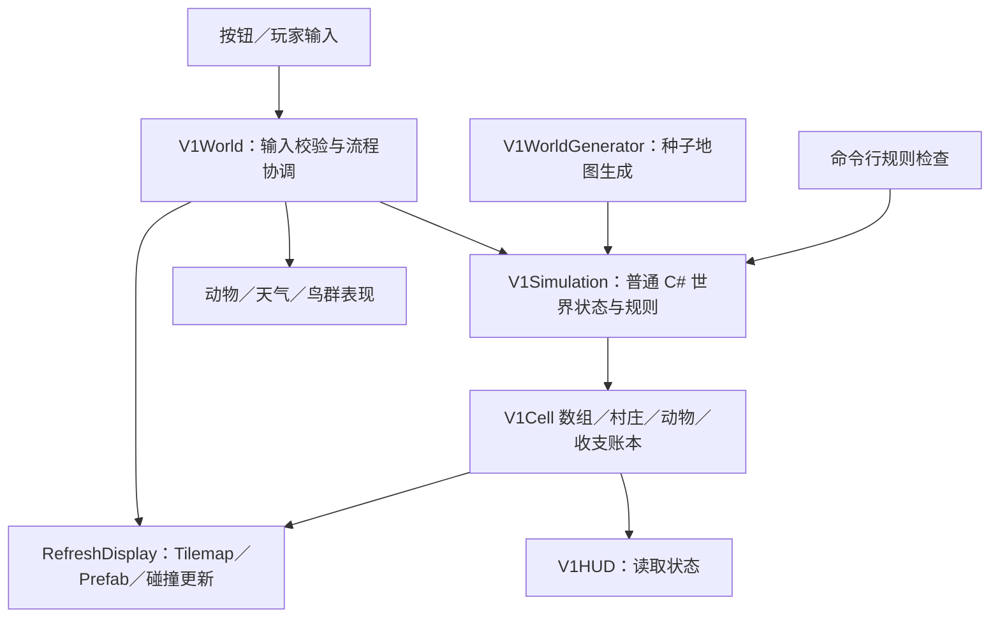

**《河岸繁荣》开发复盘与作品集评估 · 2026-10-17**

结论：可以作为 Unity 客户端／玩法开发方向的简历项目。最值得展示的是可独立运行的生态模拟、明确的时段结算、程序化地图和长期回归验证。`sealed`、脚本少和“看过全部代码”本身不能证明开发能力。需要能独立解释取舍、修改规则、定位错误并验证结果。

本次检查了实际 Unity 工程 `C:/Users/DLQian/GameJam` 的代码、场景序列化配置、构建场景列表，以及交付工作区的规则测试、开发日志与构建报告。当前 EmergenceV1 的 21 个源文件与 Unity 工程对应文件逐个 SHA256 相同。旧项目重点抽查 GitHub 上两个与你的 Unity 开发直接相关的仓库，没有对全部 GitHub 仓库、全部历史提交或旧项目运行效果做审计。

GitHub 样本固定为：

- [Unity-Lightweight-2D-Combat-Framework](https://github.com/daiyzl/Unity-Lightweight-2D-Combat-Framework/tree/0e9e460ddcb905785dfef54284cf3018824faf5c)，提交 `0e9e460ddcb905785dfef54284cf3018824faf5c`。
- [unity-](https://github.com/daiyzl/unity-/tree/1ee819bc3464f2c6e4a8f69468c06536f7f7d59e)，提交 `1ee819bc3464f2c6e4a8f69468c06536f7f7d59e`，README 明确说明基于 Unity Learn Adventure 教程进行扩展。
- `SMB-clone` 的仓库元数据表明它是 `linhdvu14/SMB-clone` 的 fork。本次不把其中全部实现归为你的原创能力；需要结合你的实际改动评价。

**1．把功能脚本挂到物体上是正常的 Unity 开发方式。**

这里有三件互相独立的事：

| 问题 | 由什么决定 | 本项目实例 |
|---|---|---|
| 能否作为组件挂在 GameObject 上 | 类是否继承合适的 Unity 组件基类，常见为 MonoBehaviour | V1World、V1HUD、TutorialCharacter |
| 别的类能否继承它 | 类是否声明 sealed，以及其他语言约束 | V1Simulation、V1AnimalView |
| 一个类是否跨多个文件定义 | partial | V1Simulation 分布在七个文件 |

`public sealed class V1AnimalView : MonoBehaviour` 既禁止别人继承，也仍然可以挂到动物对象上。代码确实用 `AddComponent<V1AnimalView>()` 动态添加它。`V1Simulation` 不能挂到物体上的原因是它没有继承 MonoBehaviour，不是因为 sealed。

sealed 不会把对象变成只读对象，不会阻止 new，不会限制为单例，也不会自动消除耦合。它表达的是“这个类型没有开放继承扩展”。性能是否获益取决于运行后端和具体调用，不应该成为本项目的主要使用理由。[Microsoft sealed 文档](https://learn.microsoft.com/en-us/dotnet/csharp/language-reference/keywords/sealed)

partial 把同一个类型的定义分放在多个文件，编译后仍然是一个类型，所有部分可以访问共同的私有成员。[Microsoft partial 文档](https://learn.microsoft.com/en-us/dotnet/csharp/programming-guide/classes-and-structs/partial-classes-and-methods)

实际场景序列化数据中，本项目自写脚本的直接挂载实例是 V1World、V1HUD、V1Camera、TutorialCharacter、TutorialWeather 各一个；这不包含 Unity／包组件、Tile 资产以及运行时创建的组件。进入游戏后，鸟群、事件、动物和死地表现等对象还会动态创建。因此只看编辑状态 Hierarchy 会漏掉一部分架构。

旧项目也已经使用普通类：战斗框架中的 `BossChase : IState` 和其他状态通过 `new` 创建；寻路项目的 AStarPathfinder 中存在 `private sealed class Node`。你已经用过这些方法，现在需要把用途与边界串起来。[BossChase](https://github.com/daiyzl/Unity-Lightweight-2D-Combat-Framework/blob/0e9e460ddcb905785dfef54284cf3018824faf5c/Assets/Scripts/Boss/BossChase.cs)、[AStarPathfinder](https://github.com/daiyzl/unity-/blob/1ee819bc3464f2c6e4a8f69468c06536f7f7d59e/Assets/Scripts/Enemies/AStarPathfinder.cs)

**2．当前项目真正的架构变化，是世界规则有了统一的数据和结算入口。**

这是主要调用关系示意。并非严格单向数据流：HUD 持有 world，world 持有 HUD；RefreshBridges 还会写回模拟状态。这些是后续可以收紧的边界。

核心对象的职责：

| 类型／文件 | 当前作用 | 你阅读时要问的问题 |
|---|---|---|
| V1Cell | 一格土地的水、木、火、污染、高度等值 | 什么字段是事实，什么字段是可推导状态？ |
| V1Settings | 模拟参数，作为序列化普通对象嵌入 V1World | 当前分支真的使用这个参数吗？ |
| V1Simulation | 状态持有、规则执行、时段推进 | 谁允许写状态？结算顺序是什么？ |
| V1WorldGenerator | 生成地形、水路、桥、居民和出生点 | 同种子如何重现？可达性如何保证？ |
| V1World | Unity 接线、输入、重开、显示、碰撞、流程 | 哪些职责应该继续拆出？ |
| V1AnimalView 等 | 视觉移动、粒子与动画 | 视觉变化是否会意外改变生态规则？ |
| V1SceneBuilder／V1CanvasBuilder | 编辑器资源和场景搭建 | 哪些设置来自生成器，哪些是人工编辑？ |
| Checks | 不启动 Unity 的规则与长期模拟验证 | 测的是完整状态，还是局部指标？ |

当前主要调用链可直接在 [V1World.cs](C:/Users/DLQian/GameJam/Assets/Scripts/EmergenceV1/V1World.cs:224) 和 [V1State.cs](C:/Users/DLQian/GameJam/Assets/Scripts/EmergenceV1/V1State.cs:229) 跟踪。

一次点击“渡过时段”会调用 `V1Simulation.AdvancePhase()`。当前默认参数把 10 个模拟秒分成 20 个 0.5 秒子步；它们在一次调用里同步计算完成，并不是让玩家等待真实的 10 秒。每个子步按顺序执行融雪、燃烧与生长、金富集、村庄生产、水流、污染；之后结算动物、村庄发展、候鸟、繁荣和教学状态。

这使规则运行速度与显示帧率分离，方便快速跑很多天。顺序本身仍然属于规则：村庄先采木再流动水，与先流动水再采木，可能产生不同结果。不能因为用了快照就宣称整个模拟没有顺序影响。

水流使用快照读取、delta 数组累积、最后统一应用，避免水从 A 到 B 后在同一遍历中又被当作 B 的旧水继续向 C 传输。输入、蒸发、植物消耗、排水等进入 Ledger，因此可以检查“结束量 ≈ 初始量 + 输入 − 消耗 − 输出”。这比“看起来水流正常”提供更强的证据。

树木出生则明确采用稳定遍历顺序预留位置，后面的候选格会看到前面已预留的树。它解决了同时萌发突破密度上限的问题，但存在固定遍历次序的偏好。面试时应该解释这一取舍，而不是把所有更新都称为无偏同步模拟。

这属于以数据为中心的普通 C# 模拟，并未实现 Unity DOTS/ECS、Job System 或 Burst 并行系统。

**3．脚本数量不是质量分数，而且这次并非在所有口径下都更少。**

以下是源文件数，不是作者贡献统计，也不是运行时实例数：

| 统计范围 | .cs 文件数 | 备注 |
|---|---:|---|
| 战斗框架 Assets/Scripts | 44 | 包含该目录内配置等代码；仓库全部 .cs 为 154，不能把第三方和示例都算作业务脚本 |
| unity- 的 Assets/Scripts | 14 | 加上 Unity 官方课程目录，仓库全部为 21 |
| 当前 Unity 工程 Assets/Scripts | 45 | 包含早期 Prototype、World、Settlement、Tutorial 等迭代代码 |
| 当前 Unity 工程 Assets 下全部 .cs | 65 | 包含 20 个编辑器相关脚本 |
| 当前 EmergenceV1 核心目录 | 21 | 11 个不引用 UnityEngine 的文件、9 个 MonoBehaviour 文件、1 个 Tile 派生文件 |

最终游戏还使用 2 个 StartMenu 文件，以及 TutorialCharacter、TutorialWeather 两个旧阶段沿用文件，因此不能把“21”当作整个最终作品的全部代码。构建场景只有 StartMenu 和 RiverbankEmergenceV1；未加入构建的旧场景，不等于旧脚本已经从工程编译中隔离。

21 个核心文件共约 2,474 个物理行，含空行和注释。大量一行多语句会压低行数，所以这个数字也不适合横向评价代码复杂度。

你以前脚本较多的合理原因包括：移动、攻击、血量、UI、动画事件确实具有不同生命周期；不同敌人需要不同状态；配置资产和运行状态分开；复用特效需要对象池。这些都是合理拆分理由。

当前文件较集中的原因包括：每个格子的状态放在数组里，不为每项资源建立组件；多种动物用枚举和统一规则处理；多个相关数据类型写在同一文件；七个文件共同组成一个模拟类；部分 Unity 职责集中在 V1World。

判断拆分是否有价值，应看修改影响范围：增加一个动物种类需要改哪里？修改血条外观是否需要动伤害结算？只改变火灾系数能否独立验证？如果增加脚本让这些事情更清晰，脚本增多就是合理代价。反过来，十几个薄脚本若互相 GetComponent、找单例、共享可写字段，文件很多也可能高度耦合。

**4．你旧项目的优势应该继续保留。**

| 维度 | 旧项目中观察到的实现 | 当前项目 | 评价 |
|---|---|---|---|
| 行为拆分 | BossIdle、BossChase、BossAttack、BossRetreat 实现 IState | 生态规则分散于一个 partial 模拟类 | FSM 适合互斥角色行为；生态系统需要多规则共同作用，两者用途不同 |
| 配置 | BossData 等 ScriptableObject，私有序列化字段与范围标记 | V1Settings 公共字段嵌在场景 | 旧方案更便于复用配置资产；当前方案依赖少但参数组织较粗 |
| UI 通信 | BossHealth 发事件，BossHealthBarUI 绑定和解绑 | V1HUD 每帧读取状态并构造很多文本 | 旧项目这部分结构更值得沿用；视觉插值仍可以每帧进行 |
| 对象复用 | 特效池、BulletPool | StageView 保留相同阶段对象，阶段变化时销毁重建 | 当前并非完全无复用，也不是完整对象池；是否池化取决于测量 |
| 脱离 Unity 测试 | 普通状态类仍直接依赖 BossFSM、Transform、Time 等 | 模拟和地图生成可由命令行编译运行 | 当前的引擎边界明显更清晰 |
| 游戏内容 | 即时战斗、跳跃、动画时机、Boss 流程 | 水、火、植物、动物、聚落的相互作用 | 展示不同能力，适合作为互补作品 |
| 工程闭环 | 有功能与发布说明 | 规则检查、长期模拟、Unity 回归与打包审计记录 | 当前验证证据更充分，但仍有覆盖缺口 |

直接证据：[BossData](https://github.com/daiyzl/Unity-Lightweight-2D-Combat-Framework/blob/0e9e460ddcb905785dfef54284cf3018824faf5c/Assets/Scripts/Boss/BossData.cs)、[BossHealthBarUI](https://github.com/daiyzl/Unity-Lightweight-2D-Combat-Framework/blob/0e9e460ddcb905785dfef54284cf3018824faf5c/Assets/Scripts/Boss/BossHealthBarUI.cs)、[ObjectPoolManager](https://github.com/daiyzl/Unity-Lightweight-2D-Combat-Framework/blob/0e9e460ddcb905785dfef54284cf3018824faf5c/Assets/Scripts/ObjectPoolManager.cs)、[BulletPool](https://github.com/daiyzl/unity-/blob/1ee819bc3464f2c6e4a8f69468c06536f7f7d59e/Assets/Scripts/items/BulletPool.cs)。

旧项目也有具体可改之处：PlayerAttack 同时查找 FSM 与 BossHealth 处理伤害，后续添加可破坏物时会继续增加类型分支，适合抽取共同受伤接口；FSM.TakeDamage 中重复执行了两次死亡判断，应清理重复分支。BossChase 虽然不是 MonoBehaviour，却直接使用 Transform、Time 和具体 BossFSM，所以“普通类”不自动等于“独立可测”。这些结论来自代码抽查，不代表旧项目运行审计。[PlayerAttack](https://github.com/daiyzl/Unity-Lightweight-2D-Combat-Framework/blob/0e9e460ddcb905785dfef54284cf3018824faf5c/Assets/Scripts/Player/PlayerAttack.cs)、[FSM](https://github.com/daiyzl/Unity-Lightweight-2D-Combat-Framework/blob/0e9e460ddcb905785dfef54284cf3018824faf5c/Assets/Scripts/FSM.cs)

**5．当前项目存在真实技术债，最先值得处理的是配置语义和模块边界。**

1. **已复现：Inspector 中部分地形参数不影响默认程序化生成分支。** 场景开启 proceduralLayout，V1World 调用 V1WorldGenerator；其 Land 方法硬编码了 .085、.17 和 7，没有使用 terrainNoiseScale、terrainAmplitude 或 generateTerrain。固定种子 317，把频率改为 .31、振幅改为 1，并关闭 generateTerrain，比较 1,120 格高度，差异为 0。旧的 V1Terrain.Generate 分支会读取这些配置，因此它们不是全局无用，而是分支语义不一致。修复时应统一参数来源，或在 Inspector 明确区分两种模式。证据：[生成器](C:/Users/DLQian/GameJam/Assets/Scripts/EmergenceV1/V1WorldGenerator.cs:43)、[本次复现输出](C:/Users/DLQian/Documents/ChatGPT/GameJam/Review/20261017/configuration-probe.txt)。

2. **V1World 职责集中。** 它同时管理输入、随机开局、资源引用、投放校验、相机复位、教程框、显示对象、桥梁、碰撞、安全传送和计时。432 行不能描述它的实际复杂度，许多行包含多个操作。下一次重构可先抽取 WorldView 和输入处理，不必一次引入庞大框架。

3. **partial 是文件组织方式，内部仍共享全部状态。** 水、火、村庄、动物等七个文件没有独立接口边界。对小规模 GameJam，这是可理解的效率取舍；继续扩展时，跨文件隐式依赖会增加。不要在简历写成“七个完全解耦的独立系统”。

4. **显示层仍写模拟状态。** RefreshDisplay 调用 RefreshBridges，后者写 Cells[i].Bridge。视觉刷新因此不完全是读取操作。建议让模拟或专门的桥梁规则计算有效性，显示层读取结果。这是分层边界问题；本次没有把它断言为已经发生的玩家故障。[V1World.cs](C:/Users/DLQian/GameJam/Assets/Scripts/EmergenceV1/V1World.cs:406)

5. **readonly 与 sealed 没有提供完整状态保护。** public readonly V1Cell[] Cells 只限制字段重新指向别的数组，外部仍能修改元素；public readonly List 同样能被增删。当前测试很方便直接构造世界，但运行接口也容易绕过规则入口。未来可逐步引入只读查询与明确写入方法，保留专门的测试构建入口。

6. **HUD 有明确的重复工作，但尚无本次性能实测。** V1HUD.Update 每帧生成状态文本、创建小数组、查询按钮子 Text；V1State.PhaseName 属性也每次 new 字符串数组。建议在时段、投放、选中格、菜单状态变化时更新相关文本，缓存静态标签与组件。需用 Profiler 比较 GC.Alloc、CPU 和 UI 重建，再报告收益。不能凭代码就声称减少了多少帧耗时。[V1HUD.cs](C:/Users/DLQian/GameJam/Assets/Scripts/EmergenceV1/V1HUD.cs:70)

7. **全量显示刷新与创建销毁有扩展成本。** 一次操作会遍历地图、设置 Tile、更新高度纹理和碰撞，阶段变化会重建部分对象。当前是 40×28 的小世界且按操作触发，可作为首版取舍。扩大地图前，应先测完整点击耗时，再考虑脏格、批量 Tile 更新或对象池。

8. **测试工程可迁移性一般。** Verify.ps1 写死本机 .NET SDK 10.0.401 和参考程序集路径；Assets 下未发现项目自有 asmdef。建议把核心和检查做成可移植的项目，或明确接入 Unity Test Framework／CI，避免他人下载后无法复现。不是必须换测试框架，重点是一条命令可重复运行。

9. **生成器验证有限。** 当前测试检查 64 个种子，长期检查四个种子；生成器在找不到安全村址／出生点时会抛异常，随机开局没有重试回退。不能由有限样本推出所有种子安全。后续可扩大种子批测，记录失败种子，再决定是否增加有界重试。

10. **代码和术语还保留迭代痕迹。** 正式玩法仍调用 TutorialCharacter.SetVerificationMovement 来锁输入；Settings 有旧分支参数，工作区有多代副本；多数代码未使用命名空间。建议优先清理误导命名和唯一源码入口。删除旧目录前必须检查对角色、天气、美术和构建工具的依赖。

**6．这次复盘做了哪些验证，哪些没有。**

本次实际执行完整 `EmergenceV1/Checks/Verify.ps1`，结果为 `PASS: 1270857 assertions`。其中包含树木密度与种子、矿物与火、水流与泥沙、村庄连续性、天气、称号、繁荣和长期运行等检查。

这个数字包含对大量格子、多个资源和多个时段的重复断言，不是一百多万个独立测试用例，也不是代码覆盖率。更好的展示方法是说明“检查什么约束、哪些输入、如何重现失败”。

另独立编译 GeneratorChecks，执行 64 个种子地图检查与四个种子的 750 天模拟，结果为 `PASS: 9176 procedural-world assertions`，完整输出保存在同目录 [generator-results.txt](C:/Users/DLQian/Documents/ChatGPT/GameJam/Review/20261017/generator-results.txt)。地图复现断言的 Signature 只编码 River、Blocked、Tree 标志，不能把该断言描述为“逐字段完整状态一致”。如要加强确定性证据，应比较完整状态、随机数状态和命令序列。

本次还执行了配置差异探针，确认默认生成分支忽略上述地形配置。探针只做观察和复现，没有修改游戏逻辑。

历史证据包括：

- [2026-10-16 Unity UI 报告](C:/Users/DLQian/Documents/ChatGPT/GameJam/EmergenceV1/Verification/HUD20261016/FinalUnityPlay/report.json)：status=passed，runtimeErrors=0，覆盖状态页、教学提示生命周期、坐标投放、称号等。
- [2026-10-17 构建报告](C:/Users/DLQian/Documents/ChatGPT/GameJam/Builds/20261017/BuildAudit/build-report.json)：Succeeded，errors=0，warnings=0。
- [分发报告](C:/Users/DLQian/Documents/ChatGPT/GameJam/Builds/20261017/BuildAudit/distribution-report.json)：启动画面渲染成功，但明确记录独立程序窗口自动激活失败，没有完成那一轮真实输入操作检查。

本次没有重新运行 Unity Play、独立程序全流程或 Profiler。历史模拟计时也不等于完整帧耗时；纯 C# 检查在 .NET 10 运行，不等于 Unity Mono／IL2CPP 性能。测试通过证明特定输入下满足已写约束，不能直接证明玩法好玩、所有种子平衡或发布版不存在问题。

**7．游戏设计层面的复盘，应把“系统会变化”和“玩家有好决策”分开观察。**

本项目具有真实的规则连锁：植被影响岸边阻力和水土，水携带污染和泥沙，沉积改变高度，高度反过来影响水流，村庄采集又改变植被与资源。它能展示系统设计和数值调试能力。

同时，玩家需要知道干预的结果为什么发生。村庄迁移、资源枯竭、火灾、自然繁荣都可能看起来像随机事件。开发日志中“第六天村庄变化”是很好的案例：先追踪同一个村庄 ID，再检查木材库存与迁移条件，最后补反馈和回归。这个过程比列举功能名称更有面试说服力。

手动时段让玩家有观察空间，也降低了实时同步复杂度；代价是每次结算必须反馈清晰，长线变化可能让玩家不知道该做什么。自然空转偶尔繁荣可以是设计的一部分，但需要确认主动干预是否仍有独特目标。有限种子里长期自然达成繁荣不是固定成功率，也不能代替用户试玩。

建议找几名没有看代码的人试玩，记录第一次有效干预时间、无法理解的状态、重开原因和是否能解释一次连锁变化。这里要采集实际数据，不能把建议中的人数和指标直接写成已完成成果。

**8．简历如何写，如何界定个人能力。**

按 Unity 客户端／玩法开发实习或初级岗位来看，它可以作为核心作品之一。它补充了旧战斗项目较少展示的规则模拟、程序化内容和验证能力；旧战斗项目仍适合展示操作、碰撞、动画、状态机与反馈。投递战斗玩法方向时可以让战斗项目在前，投递模拟、经营或系统玩法方向时可以让河岸繁荣在前。这是基于作品内容的匹配建议，不是对招聘结果的保证。

可以使用这样的项目描述，职责动词必须按本人实际贡献调整：

> 河岸繁荣｜Unity 2D 生态模拟游戏（GameJam）
>
> 参与／负责五行生态规则设计、需求迭代与 Unity 集成验收，协作完成可游玩的 Windows 版本。
>
> 将生态状态与显示分离，采用纯 C# 网格模拟和手动时段结算，实现水流、污染输运、火蔓延、植被生长与聚落演化。
>
> 使用种子生成地形、河道、桥梁和初始生态，并通过多种子与 750 天长期模拟检查资源收支、地图可达性和运行稳定性。

如果主要代码由 AI 生成、你主要负责需求和试玩，就把实际贡献写准确，例如“设计玩法规则并使用 AI 辅助实现，负责规则校核、Unity 集成、缺陷复现与验收”。只有独立完成了相应代码或重构，才写“独立设计并实现该模块”。读懂代码不等于亲自实现，但能够独立维护和修改仍然是有价值的能力证据。

不要把尚未实现的东西写进去：完整存档／回放、跨平台逐位确定性、DOTS/Burst 并行、大地图高性能、完整远程热更新服务。当前 PlayerPrefs 保存称号不等于保存整个世界；固定种子不等于完整回放。

更适合展示的三个技术故事：

1. **长期水淹问题。** 如何发现侵蚀和沉积换算不一致，为什么反复搬运会抬高河床，如何统一尺度并用长期模拟与收支误差验证。
2. **村庄迁移问题。** 如何用身份 ID 和资源库存区分“对象丢失”与“规则导致迁移”，如何让反馈与规则一致。
3. **地图生成问题。** 河道如何连接出口、桥怎样连接陆地、出生点如何避免不可达、有限种子测试覆盖了什么。

准备一个 60～90 秒演示视频、可运行包、清晰 README、架构说明、个人贡献说明和一个可重现的技术案例，比再堆几个功能更能帮助别人判断你的能力。

**9．从“全部看过”到“能够独立开发”，可以用这些任务检验。**

| 自测任务 | 通过标准 |
|---|---|
| 不看笔记讲一次投放和时段推进 | 能追踪 UI → World → Simulation → 数据 → 表现，并解释 dt 和顺序 |
| 解释 sealed、partial、MonoBehaviour、readonly | 能各给一个本项目例子，说明它们没有解决什么问题 |
| 独立修复地形参数无效 | 同种子同配置仍复现，改变振幅改变高度，明确开关含义，现有规则检查通过 |
| 把 HUD 状态文字改为按变化更新 | UI 行为一致，用真实 Profiler 数据证明减少了什么工作 |
| 复现一个火或水的错误 | 构造最小地图，写失败断言，定位原因，修复后通过回归 |
| 设计一次存档格式 | 包含格子、村庄、动物、时段、设置、随机数状态和版本，解释为何仅保存种子不够 |
| 扩展一种新规则 | 能列出修改边界、测试输入、潜在副作用，不需要整体重写 |

最适合你现在亲手做的是前两个改动：修复地形配置，再改 HUD 更新。这两个任务范围可控，也正好检验数据流、Inspector、规则边界、事件和性能测量。它们尚未由本次复盘替你改完，适合形成清晰的个人改动记录。

**10．下一阶段按成本和价值排序。**

1. 把源码、场景、资源、依赖、运行版本与个人贡献说明整理成可复现作品集入口；保留开发过程和引用来源。
2. 修复默认地图分支的配置语义，补能失败再通过的回归；完善关键场景引用和参数校验。
3. 手动完成最终独立程序的一轮完整验收：启动、选季节、进入世界、投放、渡过时段、结算、返回菜单、重开。
4. 对真实发布环境测量完整结算与界面开销，然后针对发现的热点修改 HUD 或显示刷新。
5. 当新增功能开始使 V1World 难以维护时，先抽取显示和输入；当规则需要替换、单独测试或多人维护时，再拆真正的规则对象。

保留旧项目擅长的组件组合、配置资产与事件通信，同时吸收本项目统一规则状态和自动回归的方法。你的下一步是能根据具体玩法选择边界，并用一次自己完成的修改证明这种选择。
